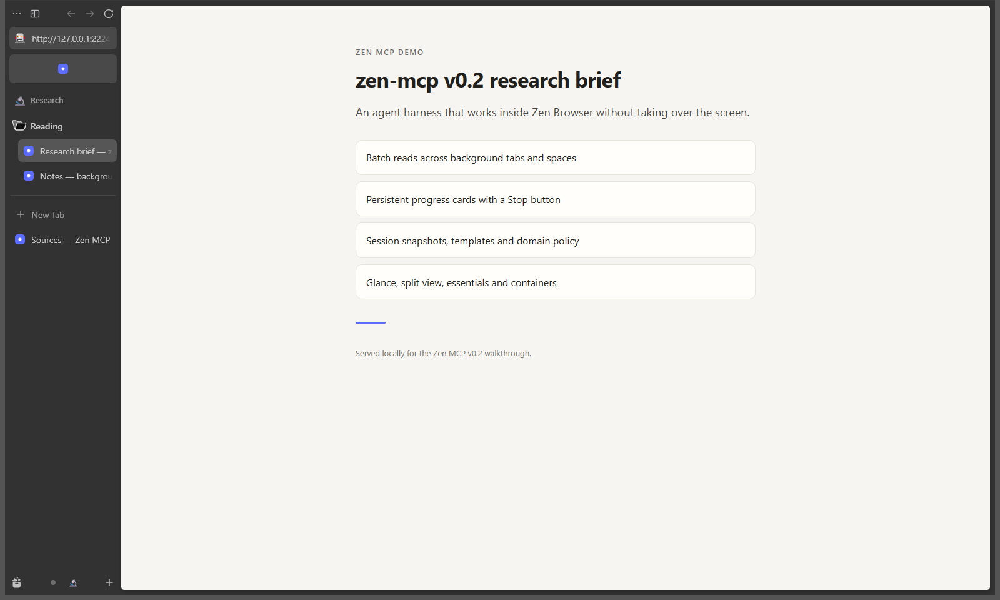

# Zen MCP

[](https://github.com/spaxe-dev/zen-mcp/actions/workflows/ci.yml)
[](https://github.com/spaxe-dev/zen-mcp/releases/latest)

An agent harness for [Zen Browser](https://zen-browser.app). Zen MCP gives an
MCP agent hands-on control of a real Zen window: native spaces, folders, tabs,
history, bookmarks, page reading, and questions that the user answers inside the
browser.

The point is that agents work *around* the user instead of taking over their
screen. A research job can open twenty tabs in a new space while the user keeps
reading, read them all in the background, ask a clarifying question in a small
corner card, and finish with a notification that jumps straight to the results.

## What that looks like

> "Make a GitHub space and find all the PRs assigned to me that I haven't replied to."

The agent:

1. creates a `GitHub` space without switching to it,
2. searches history and bookmarks for the user's repositories,
3. opens the PR list and each PR in the background (Zen stays on the current page),
4. reads every tab through the agent bridge, without selecting anything,
5. answers in the chat, then shows a card: **"4 PRs need a reply" — Open GitHub**.

One click takes the user to the space with all the work already laid out.

## What's new in 0.3

- **An owned browser, not an attached one.** Zen MCP launches its own Zen,
  proves through a per-launch nonce that the browser on the Marionette port is
  the one it started, then closes every other connection and the listener. After
  startup, no other local process can open a Marionette session. The browser is
  quit when the server stops.
- **One-time approval and a global pause.** A card in Zen asks whether this
  session may control the browser; declining closes it. The persistent banner
  has a **Pause** button that blocks every read and change immediately, and
  **Resume** turns access back on.
- **A dedicated agent profile is the default.** Opt into your normal profile
  only when the agent should see signed-in pages.
- **Evidence Mode.** `zen_show_evidence` reuses or opens the source tab, finds
  the cited passage, scrolls to it, and marks it with a temporary overlay,
  without taking over the screen; the card gets a **Show source** action and
  `focus: true` brings the tab forward on request. A card in browser chrome
  names the claim, source, match method, and confidence.
  `zen_show_evidence_batch` does the same for up to 20 citations and reports
  each result. `zen_clear_evidence` removes the marks; the page's own text and
  styles are never modified.
- Scoped reads now fail with `selector_not_found` instead of silently returning
  the whole page when the selected element is absent.

## What's new in 0.2



- Batch reads up to 10 background tabs per call, with `text`, `markdown`,
  `links`, `tables`, `metadata`, `outline`, or a CSS-selected element.
- A persistent progress card with a real **Stop** button, plus one event stream
  for Stop presses, watch hits, and question answers.
- Watch mode for text changes and selectors that appear or disappear.
- Session snapshots and space templates for repeatable research layouts.
- Tab audit, domain grouping, recently closed tabs, clipboard handoff, Glance,
  split view, pinned and essential tabs, and Firefox containers.
- A read-only mode, a domain allowlist, and a JSONL audit log.
- MCP resources for live state and prompts for common research and triage jobs.

More screenshots: [progress and Stop](docs/screenshots/v0.2-progress-stop.png),
[split view](docs/screenshots/v0.2-split-view.png),
[question card](docs/screenshots/v0.2-question-card.png),
[Glance](docs/screenshots/v0.2-glance.png).

## Requirements

- Node.js 22 or newer (Node 22 and 24 are tested in CI).
- Zen Browser, with this support status:

  | Platform | Status |
  | --- | --- |
  | Windows | Live-tested with Zen 1.24b |
  | macOS | Code paths implemented and covered by CI; live launch not yet verified |
  | Linux | Code paths implemented for distro, Flatpak, and Snap builds; live launch not yet verified |

  The Firefox mechanisms (Marionette, profile locking, and remote chrome
  access) are shared across platforms, but "not yet verified" means nobody has
  run a real Zen launch there. Treat those platforms as untested until a live
  launch, the consent card, and a clean shutdown have passed.
- Zen MCP must start Zen itself. Firefox only exposes chrome-level remote
  control when the browser process is launched with `MOZ_REMOTE_ALLOW_SYSTEM_ACCESS=1`,
  and the harness sets that only in the child process it spawns. A Zen that was
  already open cannot be adopted, and a normal Zen launch never opens a debug
  port.
- The default agent profile is separate from your normal browsing profile.
  `zen-mcp setup --use-default-profile` opts into your normal profile, which
  lets the agent see pages where you are signed in.

## Install

With Node.js 22 or newer:

```sh
npm install -g @spaxe-dev/zen-mcp
zen-mcp setup
```

Or run the setup without a global install:

```sh
npx @spaxe-dev/zen-mcp setup
```

Each GitHub release also attaches a package tarball and a `SHA256SUMS` file:

```sh
npm install -g ./zen-mcp-0.3.2.tgz
zen-mcp setup
```

The installed command is `zen-mcp` in every case. `setup` detects Zen, writes a
config, and prints an MCP snippet.

## Install from source

```sh
git clone https://github.com/spaxe-dev/zen-mcp.git
cd zen-mcp
npm install
npm run build
npm link            # optional: puts `zen-mcp` on PATH
```

Then check the machine:

```sh
zen-mcp setup   # detects Zen, writes a config, prints an MCP snippet
zen-mcp doctor  # config, executable, Marionette, bridge, policy
```

`setup` writes `$APPDATA/zen-mcp/config.json` on Windows or
`~/.config/zen-mcp/config.json` elsewhere. Nothing is installed into Zen
itself: the bridge is injected at runtime.

## Connect an MCP client

Claude Code:

```sh
claude mcp add zen-mcp -- zen-mcp serve
```

Any MCP client:

```json
{
  "mcpServers": {
    "zen-mcp": {
      "command": "zen-mcp",
      "args": ["serve"]
    }
  }
}
```

If the package is not on `PATH`, use the absolute path to `dist/cli.js` as the
command. `serve` is also the default when the CLI is run without arguments.

The server owns the browser it uses. The first tool call launches Zen with a
dedicated agent profile if `autoLaunch` is enabled (the default), then waits for
the approval card in Zen before returning. That first call can take a few
seconds while Zen starts. If Zen is already running on the Marionette port, the
server refuses to attach and explains how to proceed; it never takes over a
browser someone else started.

A running browser is quit when the MCP server stops. Leave the server running
for the whole session, and expect the agent's Zen window to close when the
client disconnects.

## Tools

### Core

| Tool | What it does |
| --- | --- |
| `zen_status` | App version, active space and tab, every space with counts, bridge health |
| `zen_launch` | Start Zen with agent access or reconnect the bridge |
| `zen_spaces_list` | Spaces with tab, pinned, and folder counts |
| `zen_space_create` | Create a space; does not switch by default |
| `zen_space_switch` | Switch the visible space |
| `zen_space_delete` | Delete a space and its tabs (destructive) |

### Tabs and layout

| Tool | What it does |
| --- | --- |
| `zen_tabs_list` | Tabs across every space, filterable by space, query, or pinning |
| `zen_tabs_open` | Open up to 30 URLs in a space, in the background by default |
| `zen_tabs_close` | Close tabs by id |
| `zen_tab_select` | Bring a tab into view (takes over the screen) |
| `zen_glance` | Preview a URL or tab in Zen's Glance overlay, without a new tab |
| `zen_split_view` | Show 2 to 4 tabs from the active space side by side |
| `zen_split_close` | Close a split view; the tabs stay open |
| `zen_pin_tabs` | Pin or unpin tabs in a space |
| `zen_essentials` | Add tabs to essentials or remove them |
| `zen_containers_list` | List Firefox containers for isolation |

### Folders

| Tool | What it does |
| --- | --- |
| `zen_folders_list` | Folders with space, label, and tab ids |
| `zen_folder_create` | Group existing tabs into a folder |
| `zen_folder_add_tabs` | Move tabs into a folder |

### Reading and research

| Tool | What it does |
| --- | --- |
| `zen_read_page` | Extract text or a structured view from any tab, without selecting it |
| `zen_read_pages` | Read up to 10 tabs in one call, three at a time |
| `zen_find_text` | Find literal text in one tab with raw offsets and excerpts |
| `zen_search_tabs` | Search up to 30 open tabs for the same text, two at a time |
| `zen_show_evidence` | Reuse a source in the background, find a cited quote, scroll to it, and mark it |
| `zen_show_evidence_batch` | Verify up to 20 citations in one call with per-citation results |
| `zen_clear_evidence` | Remove Evidence Mode overlays from one tab or every marked tab |
| `zen_tabs_audit` | Find duplicate, stale, and domain-clustered tabs |
| `zen_tabs_group` | Create one folder per domain for ungrouped tabs |
| `zen_history_search` | Search history by title or URL, optionally by domain |
| `zen_history_recently_closed` | Recently closed tabs |
| `zen_bookmarks_search` | Search bookmarks by title or URL |
| `zen_clipboard_write` | Copy text to the user's clipboard |

### Coordination

| Tool | What it does |
| --- | --- |
| `zen_progress` | Show or update a persistent progress card with a Stop button |
| `zen_events` | Long-poll for Stop presses, watch hits, and question answers |
| `zen_ask` | Show a question card in Zen and wait for an answer |
| `zen_answers` | Pending and recently answered questions |
| `zen_notify` | Status card with an optional "open this space" action |
| `zen_watch_add` | Watch a tab for a text change or a selector appearing or disappearing |
| `zen_watch_list` | Active watches with interval, expiry, last check, and hit count |
| `zen_watch_remove` | Stop and remove a watch |

### Sessions and templates

| Tool | What it does |
| --- | --- |
| `zen_session_save` | Snapshot every space, tab, folder, and essential in the window |
| `zen_session_list` | Saved sessions with counts |
| `zen_session_restore` | Restore a session, reusing spaces by name or creating new ones |
| `zen_session_delete` | Delete a saved session |
| `zen_space_templates` | Built-in and user templates |
| `zen_template_apply` | Create a space from a template |
| `zen_template_save` | Save a live space as a reusable template |
| `zen_template_delete` | Delete a user template |

### Policy

| Tool | What it does |
| --- | --- |
| `zen_config` | Effective read-only mode, allowlist, audit settings, and data directory |
| `zen_audit_tail` | Recent tool calls, including blocked ones |

### Resources and prompts

Five MCP resources expose live state as JSON: `zen://status`, `zen://spaces`,
`zen://tabs`, `zen://questions`, and `zen://watches`.

Three prompts set up common jobs: `zen_github_triage` for notifications and pull
requests, `zen_research_brief` for a source-backed brief, and `zen_clean_tabs`
for tab cleanup with a session saved first.

### Client-visible behavior

Zen MCP uses the standard MCP request metadata rather than a custom side channel:

- **Structured results.** Every tool declares an `outputSchema`. A successful
  call returns the typed object in `structuredContent` and the same JSON in a
  text block, so older clients keep working. Errors are `isError: true` with no
  `structuredContent`.
- **Progress.** When a client supplies a progress token, `zen_read_page`,
  `zen_read_pages`, and `zen_show_evidence_batch` send
  `notifications/progress` between phases or after each tab or citation. No
  token means no notifications.
- **Cancellation.** A cancelled request stops waiting on the bridge and returns
  a cancellation error. A browser command that is already in flight may still
  finish in Zen, but the server never reports it as a success.
- **Resources.** All five resources carry a title. Successful tools that change
  tabs or spaces emit `notifications/resources/list_changed` so clients can
  refresh. Resource subscriptions are not offered in 0.3; clients re-read on
  demand. Completion is not offered either, because the fixed resource URIs
  have no template variables to complete.
- **Logging.** Server warnings and errors reach the client through
  `notifications/message`. Messages contain the tool name, error code, and a
  sanitized description with URLs replaced by `[redacted-url]`. They never
  contain arguments, page text, tab URLs, or bridge keys. The file audit log
  remains the durable record.

## Reading pages in the background

`zen_read_page` and `zen_read_pages` never change what the user is looking at.
They go through the browser's own content actor, which can reach a loaded tab in
any space, including spaces that are not currently rendered.

Formats:

- `text`: readable page text, preferring `<article>`, `<main>`, or `role=main`.
- `markdown`: headings, lists, links, and tables as Markdown.
- `links`: unique http(s) links with their text.
- `tables`: table captions, headers, and rows.
- `metadata`: title, description, canonical URL, Open Graph tags, and language.
- `outline`: the heading tree.
- `selector`: limit any format to one CSS-selected element.

The result includes the title, URL, selected text, content type, length,
`offset`, and `nextOffset`. `maxChars` limits each chunk (24,000 by default,
60,000 maximum).

Long `text` and `markdown` reads are paged. Pass `nextOffset` from one result as
`offset` on the next call; `nextOffset` is `null` when the stream is exhausted.
Offsets are clamped to the page length, so reading past the end returns empty
text instead of an error.

```text
zen_read_page { tabId: "42", maxChars: 24000, offset: 0 }
→ { text: "...", length: 85213, offset: 0, nextOffset: 24000, truncated: true }

zen_read_page { tabId: "42", maxChars: 24000, offset: 24000 }
→ { text: "...", length: 85213, offset: 24000, nextOffset: 48000, truncated: true }
```

`zen_read_pages` applies the same offset to every tab in the batch. `links`,
`tables`, `metadata`, and `outline` ignore `offset` and return their complete
structured data with a `limitation` note, because a character cursor does not
map cleanly to a list of items.

Offsets are positions in the extracted text, not the raw HTML. They stay stable
while the page is unchanged. If the page changes between calls, earlier offsets
can shift, so start again from offset 0 when the content has changed.

PDF text is extracted through Zen's PDF viewer. Firefox only initializes that
viewer for a visible PDF tab, so a PDF opened in a hidden space returns
`pdf_unreadable`; ask the user to open it, then read the active tab. HTML pages
have no such restriction.

Pages that cannot expose a document (privileged `about:` pages, tabs that have
not loaded) return a clear error instead of partial nonsense.

## Evidence Mode

An answer is only as useful as the user's ability to check it.
`zen_show_evidence` turns a citation into something visible without interrupting
the user: it reuses or opens the source tab in the background, finds the cited
passage, scrolls to it, marks it, and shows a card in browser chrome with the
claim, source, excerpt, and match status. The card has a **Show source** action;
pass `focus: true` when the user asked to see the source immediately.

```text
zen_show_evidence {
  url: "https://example.com/report",
  claim: "The pilot cut response time in half",
  quote: "Median response time fell from 42 seconds to 21 seconds.",
  context: "Results after the six-week pilot",
  source_title: "2026 operations report"
}
```

The flow:

1. Reuse an open tab whose URL matches the source, or open the URL in the
   background. A supplied `tab_id` is used only when that tab still shows the
   same URL. `focus: true` switches to the tab and brings its window forward.
2. Wait up to 12 seconds for the document to leave `about:blank` and finish
   loading.
3. Read the page's rendered text through the Marionette content actor.
4. Locate the quote, then verify the page text has not changed before marking.
5. Scroll the passage toward the center of the viewport.
6. Paint an absolutely positioned overlay over the passage. The overlay fades
   out after 20 seconds by default.
7. Return structured JSON and show an activity card with a dismiss button.

### Input

| Field | Required | Meaning |
| --- | --- | --- |
| `url` | yes | `http(s)` source URL. A missing scheme is assumed to be `https`. |
| `quote` | yes | The passage expected in the source, up to 20,000 characters. |
| `claim` | no | The claim the passage supports. It becomes the card title. |
| `context` | no | Nearby source text, used to choose between repeated passages. |
| `source_title` | no | Human-readable source name for the card. |
| `tab_id` | no | Reuse this tab only if it still shows `url`. |
| `min_confidence` | no | Fuzzy-match threshold from 0.5 to 1. Defaults to 0.85. |
| `highlight_ms` | no | How long the mark stays visible, 1,000 to 120,000 ms. Defaults to 20,000. |
| `focus` | no | Bring the source tab and window to the front. Defaults to `false`. |

`zen_clear_evidence` takes an optional `tab_id`. With no id it removes marks
from every tab marked during the server session.

### Result

```json
{
  "ok": true,
  "tabId": "42",
  "tabReused": true,
  "focused": false,
  "sourceUrl": "https://example.com/report",
  "url": "https://example.com/report",
  "title": "2026 operations report",
  "claim": "The pilot cut response time in half",
  "matchedQuote": "Median response time fell from 42 seconds to 21 seconds.",
  "matchMethod": "normalized",
  "confidence": 0.99,
  "occurrences": 1,
  "scrolled": true,
  "highlighted": true
}
```

A failure sets `ok` to `false`, adds `error: { code, message }`, and never
highlights a different passage. Some successes carry a `limitation` string, for
example when the page was too large to search completely or the passage has no
visible box to paint.

| Code | Meaning |
| --- | --- |
| `PAGE_NOT_FOUND` | The tab closed, navigated away, or could not be reached. |
| `PAGE_STILL_LOADING` | The document did not finish loading within 12 seconds. |
| `QUOTE_NOT_FOUND` | The quote is absent from the page's readable text. |
| `AMBIGUOUS_MATCH` | The passage repeats and no context selected one occurrence. |
| `LOW_MATCH_CONFIDENCE` | The closest fuzzy passage is below the threshold. |
| `HIGHLIGHT_FAILED` | The page changed too often between matching and marking. |
| `PRIVILEGED_PAGE` | The tab is on a browser-internal page. |
| `ACTOR_UNAVAILABLE` | Marionette no longer exposes the content actor. |
| `UNSUPPORTED_PAGE` | PDF, non-HTML, or non-`http(s)` content. |

### Matching behavior

Matching runs in fixed code inside the bridge, in this order:

1. **Exact.** A raw substring match with exact offsets, including case.
2. **Normalized.** HTML entities are decoded; typographic quotes, dashes, and
   ellipses are folded; Unicode is NFKC-normalized, lowercased, and stripped of
   diacritics; whitespace is collapsed. Offsets are mapped back to the raw page
   text so the highlight covers the original characters.
3. **Context.** When the quote appears more than once, the 800 characters around
   each occurrence are scored against `context` using token containment and
   bigram overlap. A clear winner is required; a tie stays ambiguous.
4. **Fuzzy.** Token-anchored windows are compared with a bounded Levenshtein
   distance. This only runs for quotes up to 300 characters and accepts a match
   at or above `min_confidence`.

The matcher never picks one of several equally plausible passages. It reports
`AMBIGUOUS_MATCH` or `LOW_MATCH_CONFIDENCE` instead. Before painting, the
highlight script re-reads the page and checks that the raw text at the chosen
offsets still equals the matched passage; if not, it re-indexes and retries, up
to three times.

### Supported pages

- `http(s)` HTML and XML documents with a loaded content document.
- Text that is rendered in the DOM and not hidden.
- Same-document content only. Text inside cross-origin iframes, shadow roots,
  images, canvas, SVG, or form controls is not searched.
- PDFs, `about:`/`chrome:` pages, `file:` URLs, and other non-HTML responses
  return `UNSUPPORTED_PAGE` or `PRIVILEGED_PAGE`.

### Limitations

- The first 600,000 characters of page text are indexed. Truncation is reported
  in `limitation`.
- Pages that continuously change can exhaust the three marking attempts and
  return `HIGHLIGHT_FAILED`.
- The mark is an overlay, not a DOM edit. Layout changes while it is visible can
  move the underlying text away from the boxes. It disappears after
  `highlight_ms`, and `zen_clear_evidence` removes it sooner.
- Only the current DOM is searched. Infinite-scroll content and content behind
  interaction are invisible until loaded.

### Security

- Agents send only `url`, `quote`, `context`, and numeric options. Every DOM
  operation is a fixed script built on the server; no agent-supplied JavaScript
  is ever evaluated.
- URLs are normalized to `http(s)` and checked against the existing domain
  allowlist. Read-only mode blocks `zen_show_evidence`,
  `zen_show_evidence_batch`, and `zen_clear_evidence` because they open or
  select a tab and add overlays.
- Overlay nodes are marked `aria-hidden`, ignore pointer events, and live in
  their own layer. The page's text nodes and styles are never modified.
- The result card is rendered in a shadow root in browser chrome through the
  existing activity-card system. Page scripts cannot reach it. Evidence Mode
  does not create a second notification system.
- The Marionette endpoint and bridge token stay inside the local server; neither
  is exposed to pages or to the agent.

### Verifying several citations

`zen_show_evidence_batch` checks up to 20 citations in one call, two sources at
a time (three maximum). Citations that share a source URL reuse one tab, and
missing sources are opened once in the background. Every citation gets its own
result with the same fields as `zen_show_evidence`, and one summary card reports
how many were verified and lists up to three failures. `focus: true` brings the
first source forward once instead of switching for every citation.

Each source may have at most 5 quotes per batch. If any citation URL is not
`http(s)`, the whole batch is rejected before a tab opens, so a bad URL cannot
pull the batch halfway through. The call reports `total`, `matched`, `failed`,
`openedTabs`, and `reusedTabs`, and `ok` is true only when every citation
matched.

## Finding text in tabs

Two read-only tools locate literal text without regex, selection, scrolling, or
highlights:

| Tool | Scope | Defaults |
| --- | --- | --- |
| `zen_find_text` | One tab | 20 matches, 120 characters of context |
| `zen_search_tabs` | Up to 30 tabs, two at a time | 5 matches per tab, 80 characters of context, 20 tabs |

Both accept a literal `query` and optional `case_sensitive`. By default matching
folds case, diacritics, typographic punctuation, and whitespace differences, so
`cafe` finds `Café` and `"hello"` finds `“hello”`. `case_sensitive` switches to
exact `indexOf`. Matches carry raw page offsets (`start`, `end`), the matched
text, and a short excerpt with ellipses.

`zen_search_tabs` searches every open tab, a `space`, or an explicit `tab_ids`
list. Each tab succeeds or fails independently, so privileged pages, PDFs, and
missing tabs appear as error entries in the results instead of failing the call.
Results are capped per tab and at 200 matches in total, and `truncated` reports
when anything was clipped. Use `zen_show_evidence` when the user should see the
passage. Like Evidence Mode, both tools search the rendered DOM text, so
infinite-scroll content and content behind interaction are invisible until
loaded.

## Progress, events, and watches

Long jobs should keep the user informed without blocking on a modal dialog:

```text
zen_progress { title: "Reading 12 sources", step: "3 of 12", progress: 0.25 }
zen_events   { after: <cursor>, waitSeconds: 25 }
```

A Stop press becomes a `kind: "stop"` event. The agent should finish the current
step, then call `zen_progress { done: true }` to clear the card. A stopped
event is not an error: it means the user asked for the job to wrap up.

The global Pause switch pushes `kind: "pause"` and `kind: "resume"` events, and
`zen_events` reports `paused: true` until Resume. While paused, every browser
tool returns the `paused` error; do not retry in a loop.

`zen_watch_add` watches a tab for:

- `change`: the page text changed, optionally only when it now contains a phrase.
- `appear`: a CSS selector appeared.
- `disappear`: a CSS selector disappeared.

Watches poll on the server, post a card in Zen when they fire, and report
`kind: "watch"` events through `zen_events`. They expire after `maxMinutes`
(120 by default), polling never goes below `watchMinIntervalSeconds`, and at
most 50 watches run at once. Adding or removing a watch changes server state,
so both tools are blocked in read-only mode.

## Sessions and templates

`zen_session_save` snapshots every space, tab, folder, pin, and essential tab in
a window. `zen_session_restore` reuses a space with the same name unless
`newSpaces` is set, skips URLs that are already open, restores folders and pins,
and reports warnings instead of failing the whole restore. Restores are limited
to 300 tabs by default.

`zen_space_templates` ships four built-ins: `research`, `github-triage`, `news`,
and `docs`. `zen_template_save` turns a live space into a user template and
`zen_template_apply` creates a new space from one, including folders. Built-in
templates cannot be deleted.

## Safety and policy

The server enforces policy outside the model:

- **Ownership.** Zen MCP launches Zen itself and only controls that browser.
  It never attaches to an existing Marionette session, and the listener is shut
  after startup.
- **One-time consent.** With `requireConsent` on (the default), the browser
  shows an approval card before any tool can read or change anything. Declining
  quits the browser. A timeout leaves the card open and the tool returns an
  error, so a later call can wait again.
- **Global pause.** The banner in Zen has a **Pause** button. Pausing rejects
  in-flight bridge requests, hides progress, defers questions, and blocks every
  browser tool with error code `paused` until **Resume**. `zen_events`,
  `zen_answers`, `zen_config`, and `zen_audit_tail` stay available so the agent
  can see the pause and local policy.
- `readOnly` rejects every mutating tool with a specific error, including
  `zen_watch_add` and `zen_watch_remove`. Reads, lists, status, questions,
  events, watch listing, and the audit log keep working. A read-only server
  also refuses to auto-launch Zen and blocks `zen_launch`, so read-only work
  never starts a process or creates a profile.
- `allowedDomains` blocks URLs outside the list before `zen_tabs_open`,
  `zen_glance`, `zen_show_evidence`, `zen_show_evidence_batch`, sessions, and
  templates run. Entries match a host and its subdomains; an empty list allows
  everything.
- `auditLog` appends one JSON line per call to `audit.jsonl` in the data
  directory, including blocked calls. Long text and sensitive arguments are
  stored as a length and SHA-256 digest, URLs keep only scheme, host, and path
  (queries, fragments, and credentials are removed), and the log rotates at
  5 MB with one backup. `zen_audit_tail` reads the tail.
- Sessions and templates are sanitized and capped before use, and are written
  atomically with owner-only permissions. A symlinked file is never written
  through.
- There are no per-action approval cards. Approval is granted once per browser
  session, and Pause is the stop switch. Use read-only mode and the domain
  allowlist when an agent should not be able to change the browser at all.

## CLI

```text
zen-mcp [serve]                 Run the MCP server over stdio
zen-mcp launch                  Launch Zen once, verify ownership, then quit it
zen-mcp status                  Print config, profile mode, and port state
zen-mcp doctor                  Check config, executable, bridge, profile, port, policy
zen-mcp setup                   Detect Zen, write config, print an MCP snippet
zen-mcp setup --use-default-profile
zen-mcp setup --dedicated-profile
zen-mcp config show             Print the config path and values
zen-mcp config set <key> <value>
```

`launch` is a one-shot self-check: it starts an owned browser, proves the
nonce and lockdown work, then quits the browser before exiting. It does not keep
a browser open for later.

Config keys: `zenPath`, `profilePath`, `useDefaultProfile`, `requireConsent`,
`consentTimeoutSeconds`, `launchArgs`, `autoLaunch`, `launchTimeoutMs`,
`askTimeoutSeconds`, `marionettePort`, `readOnly`, `allowedDomains`,
`auditLog`, `dataDir`, `autoAttachWindows`, `watchMinIntervalSeconds`.

`config set` accepts `true` or `false` (also `1`/`0` and `yes`/`no`), numbers
within their allowed range, a comma-separated `allowedDomains` list, and
whitespace-separated `launchArgs`. Environment overrides are never written back
into the file. `doctor` also prints a **Policy** line that warns when consent,
read-only mode, the domain allowlist, or the audit log is weakened, when extra
launch arguments are set, or when `ZEN_MCP_BRIDGE_SCRIPT` replaces the bundled
bridge.

Environment variables override the file:

| Variable | Effect |
| --- | --- |
| `ZEN_MCP_CONFIG` | Config file path |
| `ZEN_MCP_DATA_DIR` | Sessions, templates, and audit log directory |
| `ZEN_MCP_ZEN_PATH` | Zen executable |
| `ZEN_MCP_PROFILE` | Custom agent profile directory |
| `ZEN_MCP_USE_DEFAULT_PROFILE` | `1` uses Zen's normal profile instead of the dedicated one |
| `ZEN_MCP_REQUIRE_CONSENT` | `0` skips the one-time approval card |
| `ZEN_MCP_CONSENT_TIMEOUT_SECONDS` | How long a tool waits for approval |
| `ZEN_MCP_LAUNCH_ARGS` | Extra Zen arguments, split on whitespace |
| `ZEN_MCP_MARIONETTE_PORT` | Marionette port (Zen currently always uses 2828) |
| `ZEN_MCP_READ_ONLY` | `1`, `true`, or `yes` enables read-only mode |
| `ZEN_MCP_ALLOWED_DOMAINS` | Comma-separated domain allowlist |
| `ZEN_MCP_AUDIT_LOG` | `1`, `true`, or `yes` enables the audit log |
| `ZEN_MCP_WATCH_MIN_INTERVAL_SECONDS` | Lower bound for watch polling |
| `ZEN_MCP_LOG` | `debug`, `info`, `warn`, or `error` |
| `ZEN_MCP_BRIDGE_SCRIPT` | Override the bundled `bridge.js` path |

Logs always go to **stderr**; stdout belongs to the MCP transport.

## How it works

```text
MCP client (Claude Code, Cursor, ...)
        │ stdio, JSON-RPC
        ▼
zen-mcp server ──── Marionette (127.0.0.1:2828) ──── Zen chrome scope
        │                                                   launch, inject,
        │ WebSocket on 127.0.0.1, random token              background reads
        ▼
bridge inside each Zen window (system principal)
        │
        ▼
gZenWorkspaces · gZenFolders · gBrowser · Places · UI cards
```

Three layers:

1. **Launch and control plane.** The harness spawns Zen with agent access and a
   random launch nonce, reads the nonce back through `Services.env` to prove the
   browser on the port is the one it started, then closes every other Marionette
   connection and the listening socket. Chrome-scope scripts are fixed server
   code for setup, diagnostics, and the content-actor read path; agents cannot
   submit arbitrary scripts.
2. **Browser bridge.** A small bundle is injected into each browser window. It
   owns the tab-id mapping, talks to Zen's internal space and folder APIs, and
   renders the UI cards in a shadow root. It connects out to the server over
   loopback with a token, so no listening port exists in the browser.
3. **MCP surface.** Tools validate input, map to bridge operations, and wrap
   errors with actionable messages. Server instructions carry the workflow
   guidance, while sessions, templates, watches, and the audit log live in the
   server process.

Space and folder operations use Zen's own JS APIs (`gZenWorkspaces`,
`gZenFolders`) rather than UI automation, so they behave like native actions.

## Security model

The threat model is a local process on the same account, a page the agent reads,
or the model itself trying to drive the browser behind the user's back. Zen MCP
is built so each of those has a hard boundary, not just a policy check. The
full threat model is in [docs/security.md](docs/security.md). To report a
vulnerability, use the private channel in [SECURITY.md](SECURITY.md), not a
public issue.

- **Chrome access is opt-in per process.** Only a Zen spawned by Zen MCP gets
  `MOZ_REMOTE_ALLOW_SYSTEM_ACCESS=1`, and only in that child's environment. No
  preference is written, so a normal Zen launch never opens a debug port.
- **The server only controls a browser it started.** Before launching, it
  refuses if the Marionette port is already open or, for the normal profile, if
  Zen is already running. There is no attach path to a user's existing browser.
- **Identity is proven, not assumed.** Every launch carries a random nonce in
  its environment. The server reads it back in chrome before touching anything,
  and also records Gecko's real `moz:processID`. On a mismatch it attaches
  nothing and kills nothing, so a racing browser is never harmed.
- **The listener is closed after startup.** The server closes every other
  Marionette connection and calls `setAcceptConnections(false)`. From then on
  the port refuses connections, so no other local tool can create a session.
  `zen_config` and `zen_launch` report `lockedDown` and the owned browser pid.
- **One-time consent.** With `requireConsent` on (the default), a card in Zen
  asks before the first read or change. Declining quits the owned browser. A
  timeout leaves the card open and returns an error; nothing is read or changed
  until the user approves.
- **Global pause.** The banner's Pause button rejects in-flight bridge
  requests, hides progress, defers questions, pauses watches, and makes every
  browser tool fail with `paused`. Resume restores access. Only local tools
  (`zen_events`, `zen_answers`, `zen_config`, `zen_audit_tail`) stay usable.
- **The owned browser is quit on shutdown.** The server tries a graceful quit,
  then a forced quit, then terminates the recorded browser process. A browser
  whose identity was never verified is never killed.
- **The bridge authenticates both sides.** It listens on `127.0.0.1` only and
  uses a fixed method map. A 256-bit key generated for the server session is
  shared only with the injected bridge, and every connection, including a
  reconnect, completes a mutual HMAC-SHA256 challenge with a fresh nonce before
  any request is accepted. There is no eval-from-agent tool; Evidence Mode passes
  only the quote, context, and offsets into scripts built by the server.
- **Input is constrained.** `zen_tabs_open` accepts only `http:`, `https:`, and
  `about:` URLs. `zen_show_evidence` and `zen_show_evidence_batch` accept only
  `http(s)` sources. Search queries are literal strings, never expressions. The
  domain allowlist is checked before mutations, sessions, and templates.
- **UI stays out of pages.** Question, notification, consent, progress, and
  evidence cards render in browser chrome inside a shadow root, not in page
  content, so pages cannot reach or spoof them.
- **Evidence marks are inert and unspoofable.** Each call gets a random marker
  attribute, highlights render in a closed shadow root that ignores pointer
  events, and clearing removes only markers the server created. The page's own
  text and styles are never changed.
- **The audit log records calls without retaining content.** One JSON line per
  tool call, including blocked calls, with redacted URLs, outcome, and
  duration. Long text and sensitive argument values become lengths and
  SHA-256 digests; the file is owner-only and rotates at 5 MB.

### Residual risks

No local browser harness can remove these. They are worth knowing before opting
into the normal profile:

- Between process start and lockdown there is a small window in which another
  local process could race for a Marionette session, because Marionette itself
  has no authentication. The server detects a competing session and fails
  closed, but the race exists.
- Any process running as the same user can read process memory, inspect
  arguments, or attach a debugger. Local tools cannot be defended against with
  cryptography alone.
- Page text read by the agent is sent to whatever model provider the MCP client
  uses. That is a data-sharing decision, not a browser-permission one.
- Using the normal profile means the agent can read pages where you are signed
  in, including personal data. The dedicated agent profile is the default for a
  reason.
- The lockdown relies on Zen's internal Marionette module layout. A future Zen
  release can change it; the server then fails to start rather than silently
  continuing without protection.

## Troubleshooting

**"Zen is not running. Zen MCP launches its own browser with agent access..."**
Nothing owns the agent browser yet and `autoLaunch` is off. Call `zen_launch`,
start the server again, or set `autoLaunch` to true.

**"Marionette is already listening on port 2828"**
Another Zen or a WebDriver session owns the port. Zen MCP will not attach to it.
Quit that browser or stop the other tool, then call `zen_launch` again. Use
`ZEN_MCP_MARIONETTE_PORT` only if another tool permanently owns 2828.

**"Zen is already running with its normal profile"**
`useDefaultProfile` is on, a normal Zen is open, and a second launch would hand
the URL to that instance instead of creating an agent browser. Quit Zen
completely, or switch to the dedicated agent profile with
`zen-mcp setup --dedicated-profile`.

**"Zen did not open Marionette on port 2828 within Ns"**
The browser never accepted the agent port, usually because it handed off to a
running Zen. The launch attempt was stopped so it cannot keep the profile
locked. Quit Zen completely and try again.

**"The browser answering on the Marionette port was not the one Zen MCP just
started"**
A second browser won the port during the startup race. Nothing was attached and
nothing was killed. Quit the browser on 2828 and retry.

**"The Marionette port could not be locked down"**
Zen started, but the internal Marionette server did not close its listener.
The server shut the browser instead of continuing without the boundary. This is
usually a Zen version change; check `zen-mcp doctor`.

**"Zen MCP is waiting for approval in Zen"**
Click **Allow this session** on the card in the agent's Zen window, then call
the tool again. The timeout is `consentTimeoutSeconds`.

**"Browser access was declined in Zen"**
The browser Zen MCP started was closed. Call `zen_launch` to ask again, or set
`requireConsent` to false if the approval card is not wanted.

**A tool fails with `paused`**
Someone pressed **Pause** in the Zen banner. The browser is blocked until
**Resume** is pressed. This is not a retryable error; wait for the user.

**"The Zen profile at ... is already open in another browser"**
The configured profile is locked by a running Zen. Quit that instance, or use
the dedicated agent profile. This check happens before spawning, so it fails
immediately instead of waiting for a Marionette timeout.

**`zen_read_page` says the page is privileged or still loading**
`about:` pages and tabs without a content document cannot be scraped. Wait for
loading to finish, or open the HTTP version of the page.

**A PDF in another space reports `pdf_unreadable`**
Firefox does not initialize the PDF viewer for a hidden tab. Ask the user to open
the PDF, then read the active tab.

**`zen_show_evidence` returns `QUOTE_NOT_FOUND`, `AMBIGUOUS_MATCH`, or `LOW_MATCH_CONFIDENCE`**
No highlight was added and the quote should not be presented as support. Copy the
passage from the page, shorten it, or add surrounding `context`. PDFs and
privileged pages cannot be inspected at all.

**A tool reports `actor_unavailable`**
The owned browser disconnected. Because the Marionette listener stays shut,
this server cannot re-attach. Quit that Zen window, then call `zen_launch` to
start a new owned browser.

**The corner cards do not appear**
Only browser windows get the bridge. New windows are attached automatically when
`autoAttachWindows` is on; a tool call also injects into a window that does not
have it yet. If cards still do not show, run `zen-mcp doctor` and check the
bridge line.

**A tool is blocked with `read_only` or `domain_not_allowed`**
Run `zen_config` to see the effective policy, then `zen_audit_tail` to see the
blocked call. Change the config file or an environment variable and restart the
server.

## Tests

```sh
npm test                     # 185 unit tests, no browser
ZEN_MCP_E2E=1 npm run test:zen
```

The integration suite has 34 tests in six groups: the MCP server against a
real headless Zen that the server launches itself, policy enforcement with
read-only and allowlist servers, the runtime against a real browser, and the
security boundary. It creates spaces, reads pages and formats, moves tabs into
folders, uses essentials, pins, containers, clipboard, progress, events,
watches, sessions, templates, recently closed tabs, and questions. The evidence
tests check exact, ambiguous, context-assisted, missing, and cleared matches,
background and focused verification, batch verification with opened and reused
tabs, literal search in one tab and across tabs, the real overlay and scroll
position in the page, and the card text in browser chrome. The security tests
click the real approval card, assert the Marionette listener is closed before
approval, reject a second client, verify Pause blocks requests and Resume
restores them, check denial quits the browser, and check shutdown quits it.

Profiles are created under `D:\tmp\zen-marionette-test` on Windows and
`$TMPDIR/zen-mcp-test` elsewhere, then removed; override with
`ZEN_MCP_TEST_PROFILE` to reuse a specific profile for debugging.

Manual probes with verbose output live in `scripts/probe-smoke.ts` (bridge, UI,
history, bookmarks) and `scripts/probe-mcp.ts` (stdio MCP round trip).

## Known limitations

- Zen's internal workspace and folder APIs can change between releases. Pin a
  Zen version if a newer build breaks spaces; the error will name the failing
  call.
- PDF text extraction requires the PDF tab to be visible; hidden-space PDFs
  return `pdf_unreadable`.
- Marionette is fixed at port 2828 in current Zen builds, so one agent browser
  per machine. Two Zen MCP servers cannot share it.
- The startup race before lockdown cannot be eliminated while Marionette has no
  authentication. The server detects it and fails closed.
- A browser whose Marionette session is lost cannot be re-attached, because the
  listener stays shut. Quit it and start a new one.
- Reads capture the current DOM text. Infinite-scroll and client-rendered pages
  only return what has loaded.
- Evidence Mode searches rendered DOM text, not pixels. PDFs, images, canvas,
  cross-origin iframes, and shadow roots cannot be searched.
- Evidence marks are temporary overlays. They can drift if the page reflows
  while visible, and pages that change constantly may return
  `HIGHLIGHT_FAILED`.
- Watches run in the server process and stop when it exits. They do not survive
  a restart.
- No screenshot or click automation inside pages. This harness is for Zen and
  agent conversation, not a full WebDriver replacement.
- No per-action approval cards. Approval is per browser session, and Pause is
  the global stop switch. Use read-only mode and the domain allowlist for
  additional guardrails.

## License

MIT. See [LICENSE](LICENSE).
